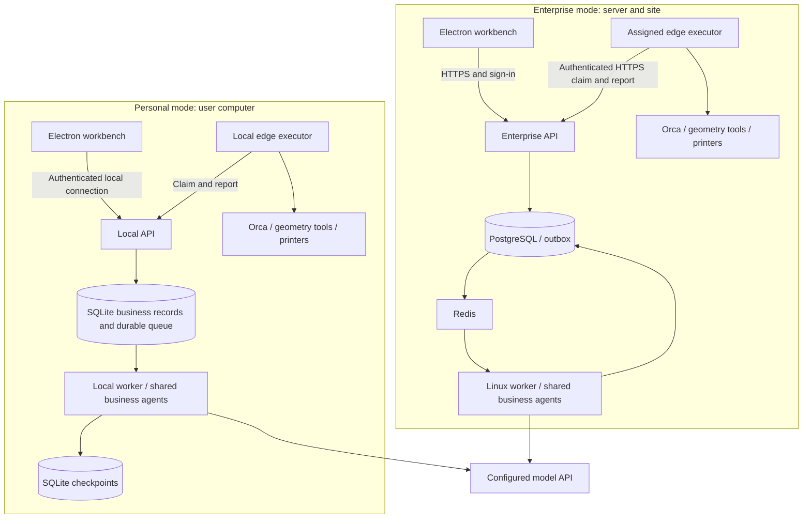

# Runtime and deployment

English | [简体中文](../../zh-CN/architecture/runtime-and-deployment.md)

Status: unimplemented design baseline. This document owns dual-mode deployment, background lifecycle, durable tasks, and edge protocols. See [requirements](../product/requirements.md), [repository structure](repository.md), and [agent roles](agent-and-tools.md).

## Deployment modes and configuration

One Electron application offers **Personal use** and **Connect to enterprise**. Both share orders, models, processes, trials, production, quality, and agents. Enterprise adds collaboration, resource authorization, and centralized operations. Execution depends on model/device capabilities, information, permissions, and human confirmation; deployment alone does not imply identical outcomes.

| Item | Personal local mode | Enterprise server mode |
| --- | --- | --- |
| Start | Install; enter API URL/key/model; test connection | Enter enterprise server URL and sign in; administrator configures models |
| Business control/agents | Independent local background processes | Enterprise intranet/cloud server |
| Business persistence | Workspace SQLite with SQLAlchemy/Alembic | PostgreSQL with SQLAlchemy/Alembic |
| Agent checkpoints | Separate SQLite storage | PostgreSQL storage |
| Background tasks | SQLite durable queue, singleton scheduler, bounded execution processes | Linux Celery/Redis and leased workers |
| Files/retrieval | Managed local files and SQLite text search | Server files/S3 and PostgreSQL text search |
| Orca/devices | Bundled local edge executor | Enterprise-registered edge on user computers or dedicated site hosts |
| Identity | Local owner, workspace authorization, endpoint authentication | OIDC, membership, RBAC/resource authorization |
| Dependencies | Bundled; no user-installed development tools/services | Administrator deploys database, queue, identity, background services; desktop users do not |

Personal mode requires no Autumn cloud account, enterprise server, Docker, Redis, PostgreSQL, or local GPU. Remote model APIs require network access and quota; users supply a local model service if desired. Check tool calls, structured outputs, and optional vision; explain incompatibility rather than silently simulating success.

Only the local model adapter uses the personal API key, stored with OS credential protection. Configuration UI receives it briefly during submission; no persistent retention/redisplay, model messages, logs, or protocol receipts. Enterprise credentials remain on the server. Model API URL and enterprise server URL are separate UI/data fields.

Locally stored data does not imply local inference: remote models receive authorized task content and necessary artifacts, not entire model/file directories by default. Show the current connection, information scope, and usage records.

## Processes in both modes

## Local background processes, durable tasks, and lifecycle

The personal installer includes desktop, managed Python runtime, API, local worker, edge, geometry dependencies, and release-reviewed fixed Orca resources, with authorized samples and compatible process profiles. Engine provenance, license/source obligations, digests, and compatible settings are release gates. Default installation must support offline dependency installation, excluding model API calls. Reusing an existing engine is optional advanced configuration; real printing still requires connecting devices and confirming materials/readiness.

The installer registers `apps/worker`'s local host as a managed current-user background process, supervising API, scheduler, and edge separately from Electron windows. OS-managed startup recovers abnormal host exits rather than relying on window memory. Workspace locks/instance IDs prevent duplicates; connect to an existing host.

Local API binds loopback only, with protected installation/workspace credentials and caller/origin checks. Desktop and edge have different permissions. Store database, files, queue, checkpoints, and journals under user data, not installation/source directories; isolate workspaces and credentials. Discover ports through protected records; never blindly trust the process occupying a port.

Task submission and business writes commit to the SQLite queue in one transaction. One scheduler atomically claims work, records leases/attempts, and runs bounded fragments with limited concurrency. Use WAL, short transactions, bounded busy waits, foreign keys, explicit uniqueness, and no PostgreSQL-only row locks/RLS/`SKIP LOCKED`. Checkpoint commits are separate; recovery reconciles business idempotency keys, run versions, and action records rather than assuming cross-database atomicity.

Persist waits for input, edge results, network, or models and release execution slots; pin graph version on recovery. Expired leases trigger reconciliation/recoverable redelivery, never another start for an unknown device outcome. Enterprise outbox/Celery shares these semantics; enable only one scheduler backend per workspace.

Closing windows or exiting desktop ends interaction, not background work/device jobs. Stopping the host is separate: stop claims, save recoverable state, explain in-flight actions. Killing a process does not stop a printer. Software does not run during shutdown/sleep; reconcile devices/actions on reboot/wake.

## Workspaces, disconnection, and personal-to-enterprise migration

Personal setup creates a local workspace/owner without OIDC, preserving person, revision, and evidence in confirmations. Enterprise uses OIDC/resource policies. Each request pins workspace, endpoint, and identity; isolate events/cache. Switching UI does not move active tasks or device control.

Personal mode can view/edit local data and run deterministic tools offline. Remote-model steps wait, then resume within budget. Approved edge tasks execute under valid local policy. Enterprise disconnection exposes cache/drafts, prohibits new server approvals/claims/starts, and allows only already accepted, still-authorized edge tasks to finish with durable receipts for reconnection reconciliation.

Do not automatically synchronize, merge, or upload personal/enterprise data. Explicit export/import validates permissions, hashes, model/process revisions, and references without copying model keys/edge credentials. Enterprise import does not inherit the owner's organization authorization. Preserve historical approvals as evidence, but reconfirm production use under enterprise policy. Do not migrate active tasks or unresolved device actions.

Device write ownership is exclusive across modes. An edge executor serves one control-plane/site identity at a time. Stop claims, reconcile in-flight actions, unbind, and explicitly register again; personal/enterprise queues must not both start the same printer automatically.

## Background execution, recovery, and redelivery

Task execution interfaces assemble two backends with shared run/event/idempotency/wait/cancel semantics. LangGraph owns fragment-internal state; the workspace database owns business facts. Enable one scheduler per workspace.

- **Personal:** transactionally persist business/tasks/queue in SQLite; singleton atomic claiming, leases, bounded concurrent fragments, WAL/short transactions. Separate SQLite checkpoints reconcile by business idempotency/version after crashes, without assumed cross-database transactions or PostgreSQL locking.
- **Enterprise:** bounded Linux Celery/Redis fragments with PostgreSQL outbox/leases. The following dispatch details concern enterprise mode; idempotency, waiting, and external reconciliation also apply locally. See [Celery FAQ](https://docs.celeryq.dev/en/stable/faq.html) and [Redis broker](https://docs.celeryq.dev/en/stable/getting-started/backends-and-brokers/redis.html).

1. Create business records, initial events, and outbox entries in one transaction.
2. Dispatch JSON with business IDs/versions/correlation, not pickle or raw large files.
3. Workers conditionally acquire valid run leases and check prior results/cancellation.
4. Use independent sessions per branch and initialize connections in worker processes; do not hold transactions over model/external waits.
5. Prefer synchronous graph calls/sessions for synchronous Celery entries. Explicitly manage loops/clients if async is required; never reuse AsyncSession across threads/old loops.
6. Checkpoint and release fragments waiting on measurements/approval; dispatch recovery on events. Submit a unique SliceRun for edge slicing, then resume on result events rather than polling offline edge while holding a worker.
7. Authorize checkpoint tenant/task ownership, ensure one writer per run, pin graph versions, and preserve action-ledger checks on node reentry.
8. Reuse business idempotency keys for outbox/broker/manual recovery. Count transport attempts separately from model/tool retries.
9. Reconcile queued/expired/dispatched-unclaimed business records periodically; reconstruct dispatch after lost Redis messages or broker recovery.
10. Ordinary failures differ from unknown external outcomes; unknowns permit only queries or human investigation.

Redis persistence/availability does not replace PostgreSQL records. Pin images and check version-specific [Redis licensing](https://redis.io/legal/licenses/); do not assume every Redis 8+ release is BSD.

Temporal is not selected. Future durable business orchestration should replace the relevant outer scheduler and revisit checkpoint ownership, not stack independent retry systems.

## Electron processes and local integration

### Main, preload, and renderer

| Process/layer | Responsibilities | Exposed capabilities |
| --- | --- | --- |
| Main | Windows, file selection, account sessions, trusted backend connection, updates, edge lifecycle status | Explicit commands/queries/subscriptions; no generic file/network/shell proxy |
| Preload | Typed contextBridge | Business operations, schemas, results, unsubscribe; not all of ipcRenderer |
| Renderer | React UI, Three.js, forms/display | Validated business calls; no Node, device credentials, arbitrary paths |
| Python Edge | Orca/geometry subprocesses, device adapters, journals | Claim authorized tasks/report results; chat text cannot directly control processes |

Window baseline: `nodeIntegration: false`, `contextIsolation: true`, `sandbox: true`. Main validates IPC origin/parameters and rejects unknown channels. Validate external schemes/domains before system-browser opening; block arbitrary navigation/popups/remote scripts in privileged UI. Test CSP and restricted `app://` handling; reject path traversal/unscoped reads. See [Electron security](https://www.electronjs.org/docs/latest/tutorial/security).

Main obtains file authorization and creates import references before upload/managed execution. Renderer names, drops, and model replies do not become arbitrary paths. Treat imported images/models/reports as untrusted; report HTML/Markdown does not execute scripts.

### Client/backend communication

Main holds a scoped session, receives SSE, and forwards authorized sequenced events. Renderer uses small interfaces such as `orders.create`, `tasks.subscribe`, `models.selectImport`, with request IDs, cancellation, timeouts, structured errors, and resource scope.

Large model files, GLB, photos, and G-code use authenticated references, streamed downloads, and restricted temporary files rather than repeated JSON IPC copies. Main/dedicated background processes handle networking/conversion without blocking windows. Unsubscribing ends observation; task cancellation is explicit.

### Window closure, exit, and offline behavior

- Closing windows and stopping edge are different. Closing UI cannot cancel printing or restart jobs automatically.
- Personal installation registers an independent current-user host supervising API/worker/edge. Desktop connects or requests startup; background survives window exit and OS mechanisms restart crashes. Enterprise server/edge processes run independently. Record versions, paths, health, and exit reasons.
- One authorized execution instance per physical device. A second client connects rather than launching a competitor.
- Display offline/last-observed times; running device jobs follow device lifecycle. Reconcile status/receipts on recovery.
- Personal offline supports local data/tools; remote-model steps wait and valid approvals remain policy-bound. Enterprise permits cache/drafts and completing previously accepted authorized work, not new approvals/claims. Shutdown/sleep suspends software; reconcile on return.
- Canceling slicing may stop its controlled subprocess. Exiting software is not a hardware stop.

### Packaging and updates

Use one chain: **electron-vite builds Main/Preload/Renderer, electron-builder packages, electron-updater handles selected channels**. Forge is an alternative, not a second chain. Its official Vite plugin's experimental status requires separate compatibility evaluation. See [Forge Vite](https://www.electronforge.io/config/plugins/vite).

First target Windows x64, then validate needed ARM64/macOS/Linux. Python, native geometry libraries, and Orca are independently versioned; asar does not automatically package/isolate them. Verify Orca installation/distribution/component licensing in the release plan.

Personal installers provide dependencies/reviewed engine resources, background registration, initialization, migration, and health checks. Users choose personal mode/configure models without development tools or enterprise services. Loopback still requires identity. Local adapters use OS-protected keys rather than exposing them to renderer; enterprise keys stay server-side. Prune dependencies per build.

Validate source/signature/digest/protocol compatibility/recoverable installation. Do not replace active engines or stop edge mid-action. Record client/backend/edge/tool compatibility; incompatible updates enter read-only/waiting with reasons. Separate development/stable/prerelease channels. No certificates or updates have been published in this work.

## Edge and device action protocol

Enterprise edge registers/authenticates, claims, heartbeats, and reports through outbound HTTPS, without central database access or public printer endpoints. Personal edge uses authenticated loopback with the same versioned command/receipt protocol and local owner authorization. Bind to one control plane; switching reconciles in-flight work before registration and prohibits dual automatic starts.

Commands carry schema version, tenant/site, task/action ID, target, file hash, configuration/approval revision, allowed action, expiry, and claim identity. Edge rechecks scope/integrity/expiry rather than trusting frontend validation.

| Action state | Meaning and next step |
| --- | --- |
| proposed | Agent/user proposal, not authorized |
| awaiting_approval | Await approval of explicit object/revision |
| ready | Approved/prerequisites met; recheck before execution |
| dispatching | Durable intent prepared for assigned edge |
| accepted | Edge durably received; not evidence of device start |
| confirmed | Correlates with actual outcome or explicit receipt |
| unknown | May have taken effect; only reconciliation/human handling |
| rejected / cancelled | Not executed or confirmed canceled; preserve affected scope |

Upload, queue, start, pause, resume, and cancel are distinct actions. Confirmed start is not completion; successful pause request does not prove a hardware-safe state.

### Single writer and replay

1. Serialize Autumn writes per device using central leases plus local process locks.
2. Persist action_id, file hash, state, and known outcome before network requests; fault-test durability policy.
3. Duplicate commands return known receipts. Unknowns query local/device jobs/files/history, otherwise require a human.
4. Expired central leases do not authorize a second start; investigate old executor/device during failover.
5. Recheck idle state, freshness, nozzle, loaded material, clear bed, and approval conditions before start.
6. Native panels/other software may still control devices. Stop automatic advancement on external occupancy/file/state conflicts; no universal exactly-once claim.
7. If SimplyPrint/Printago owns queue/start, integrate through it without another competing automatic queue.

Implement Fake and test duplicates/timeouts/disconnection/external occupancy before one authorized test printer. Evaluate Moonraker for Klipper, existing OctoPrint interfaces where deployed, and add other brands with explicit capabilities.

## Deployment, versions, and recovery

Develop in the fixed monorepo. Personal profile starts native API/local durable worker/SQLite/edge. Enterprise integration uses Docker Compose for API/Linux worker/PostgreSQL/Redis/IdP. Compose is an enterprise/development tool, not a personal prerequisite. Windows edge tools remain native.

Deploy enterprise control on intranet/cloud; edge connects outbound and Electron uses an administrator-confirmed server. Production requires TLS, identity, rotation, backups, and least privilege.

Personal data lives outside installation directories; enterprise data stays in enterprise storage. Workspace switching pins endpoint/identity/cache without moving tasks/uploading data. Explicit migration verifies hashes/revisions/permissions and enterprise reapproval; excludes keys, edge credentials, active tasks. SQLite backup must capture a consistent snapshot, not just copy the main file while omitting WAL. Manifests/reconciliation link files, business data, and checkpoints.

Version client/backend interfaces, edge protocol, graph/roles, models, settings, engine, parser, native tools. Negotiate capabilities before writes; reject incompatible operations. Exercise migration, backup, retention, and restore; downgrading binaries alone is not data rollback.

Back up ArtifactStore and corresponding metadata; verify lengths/hashes/revisions when moving to S3. Reconcile actual devices before redispatch after restore; old backup actions are not new start authorization.

## Runtime details pending implementation

Validate the concrete Windows background-registration mechanism, first credential provisioning/handoff, and update/uninstall order. Managed background execution is not already implemented. Bootstrap uses Fake tools for protocol/lifecycle checks; real installers follow the [validation plan](../engineering/validation.md).
