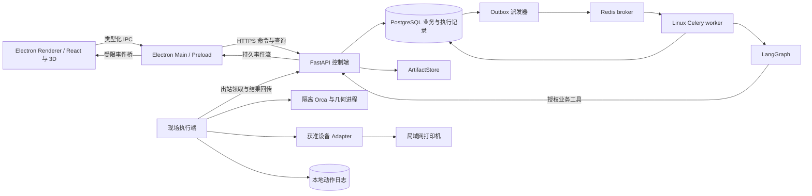

# Autumn Print 技术设计

设计日期：2026-10-29（Asia/Shanghai）。状态：待实现的设计基线，尚未安装依赖、执行切片或接通设备。

本文明确整套应用的技术、模块、数据与执行约束。[guide.md](../guide.md)规定持续集成的业务路线；[技术调研](../research/technology-selection.md)保存高 Star 项目、近期发布、许可证和取舍依据；[领域语言](../CONTEXT.md)规定业务术语。

## 1. 设计结论与假设

采用 **Electron 桌面客户端 + React/Three.js 界面 + Python 模块化单体 + Linux 后台 worker + Windows/现场执行端**。第一版可以在同一台开发电脑运行，之后按职责分别部署，不先拆成微服务。

- 目标是 FDM 工艺验证与小批量生产，先验证一组设备/喷嘴/材料和固定订单样例。
- 按用户要求以 Electron 桌面端为主要交付，先 Windows，随后分别验证 macOS/Linux 打包；渲染进程不直接持有打印机凭据。
- PostgreSQL 保存业务事实，LangGraph 保存推理执行进度，Celery/Redis 负责后台投递，本地动作日志保护设备操作。
- 项目尚未得到实际打印机清单。第一个真实设备 Adapter 依据测试设备选择，不能预设所有机器都支持 Moonraker 或 OctoPrint。
- 所有版本号是调研/兼容性候选，实际依赖以引入阶段验证后的锁文件、镜像摘要和二进制哈希固定。

## 2. 全部技术的选定用途

| 层 | 基线选择 | 引入时机与理由 |
| --- | --- | --- |
| Python 运行与依赖 | Python 3.12 的受支持补丁 + uv + uv.lock | 阶段 0；延续指南，先验证几何库原生轮子和工具兼容 |
| 桌面前端 | Electron + React 19 + TypeScript + electron-vite + pnpm | 阶段 3；主进程、preload 与 renderer 分开构建；渲染层使用 Vite，首期不需要 SSR |
| 桌面分发 | electron-builder + electron-updater | 阶段 3 起验证安装包；阶段 11 完善签名、更新渠道、安装与恢复，不并用 Forge 主构建链 |
| 3D | Three.js + React Three Fiber 稳定 v9 | 阶段 3；模型、打印床、朝向、检查标记与候选比较 |
| UI 与数据 | shadcn/ui、Tailwind、TanStack Query；复杂清单按需 TanStack Table | 阶段 3 起；查询状态和视图状态分别管理 |
| 前端构建环境 | Node.js 24 LTS 基线；26 LTS 经工具链验证后可升级 | 构建 Node 与 Electron 内置 Node/Chromium 分别记录；electron-vite 的 Vite 版本按兼容范围选择，不直接强制最新版 Vite |
| 业务接入 | FastAPI + Pydantic + Uvicorn | 阶段 3；输入校验、权限、命令、查询、SSE 和文件访问 |
| 持久化 | PostgreSQL 18 稳定分支 + SQLAlchemy 2.x + Alembic + psycopg | 首个持久业务版本；2.x 小版本经兼容性验证后固定，不以旧教程代替当前版本 |
| Agent | 单一 LangGraph 运行体系 + 经验证的模型供应商 Adapter | 单 Agent 阶段先用小图，阶段 6 增加委派、分支、等待与恢复 |
| 后台执行 | Linux Celery + Redis broker | 阶段 3 的桌面任务后台起；阶段 10 完善部署与容量，Windows 现场端不运行 Celery |
| 现场端 | Python 独立进程 + 本地 SQLite 动作日志 + 受限工具子进程 | 阶段 1 先本机执行，阶段 7 完善身份、领取与设备动作 |
| 切片 | 固定并验收的 OrcaSlicer 稳定二进制 | 阶段 1；当前候选 v2.4.2，2.5 Alpha/本地 dev 作为后续插件研究 |
| 几何检查 | Trimesh + 明确覆盖的小型检查逻辑 | 阶段 1；报告逐项给出通过/失败/未知/不支持 |
| 网格修复 | 受限小修复；复杂情况按需隔离 PyMeshLab | 通过缺陷样件验收后才启用，不默认复杂拓扑可修 |
| 设备 | Fake + Moonraker 或 OctoPrint 中一个真实 Adapter | 阶段 7；按实际设备选择，声明能力矩阵 |
| 文件 | 本地 ArtifactStore；企业部署复用已有 S3 或评估 SeaweedFS | 本地先行，阶段 10–11 验证 S3；不先搭分布式存储集群 |
| 身份与授权 | OIDC；默认自托管提供方 Keycloak，也可接企业已有 IdP；应用内 RBAC + 资源策略 | 阶段 3 开始真实身份和基本授权，阶段 10 完善管理与 SSO |
| 知识检索 | PostgreSQL 元数据/全文检索；需要时 pgvector | 阶段 5；按实际中文/技术术语召回集选择索引与 embedding |
| 生产计划 | 先确定性兼容筛选和可解释启发式；达到需要时 OR-Tools CP-SAT | 阶段 8；LLM 提出约束，实际可行性由程序检查 |
| 耗材与监控 | 本地材料台账；Spoolman、Obico/Gadget 按需接入 | 阶段 8–9；各自明确唯一数量事实来源和设备控制权 |
| 验证 | pytest、Vitest、Testing Library、Playwright | 业务、工具、Electron 窗口与 IPC、3D 逐层测试；实物另行验证 |
| 质量与运维 | Ruff、类型检查、OpenTelemetry、结构化日志、Docker Compose、CI | 基础检查从首期开始，遥测后端按规模接入 |

Node LTS 依据见[官方版本表](https://nodejs.org/en/about/previous-releases)。其余选型与本次版本快照见[调研](../research/technology-selection.md)；精确补丁尚未形成经过安装验证的依赖集合。

## 3. 高关注项目如何参考

| 参考项目 | 学习内容 | 在 Autumn 中的处理 |
| --- | --- | --- |
| OpenClaw / Hermes | 本地运行、工具策略、历史信息与技能 | 借鉴机制；不直接开放通用 Shell 或任意设备操作 |
| DeerFlow | 长任务、受限子 Agent、成果、任务工作台 | 借鉴交互和组织方式，围绕打印业务实现 |
| OpenHands | 控制界面与执行后端拆分、隔离工作区 | 用于中心/现场端设计参考，不引入编码 Agent 充当生产控制器 |
| LangGraph | 节点、分支、中断与持久 checkpoint | 采用其图运行能力，业务状态由本项目拥有 |
| OrcaSlicer | 配置、切片、校准、设备适配经验 | 通过固定版本工具接入，避免初期维护大型 C++ 分叉 |
| Printago / SimplyPrint | 订单、队列、材料匹配、清床与生产交接 | 对照已有能力；若已作为机群调度方，则 Autumn 通过其接口工作 |
| Trimesh / PyMeshLab | 几何事实和限定修复能力 | 由工具返回检查证据，不让语言模型虚构几何结果 |

这些是有官方来源的代表性样本，不是全 GitHub 排名。关注度和更新时间均不足以证明对物理生产的可靠性。

## 4. 部署关系

图中的授权业务工具通过同一进程可直接调用 Module Interface；不要求每次推理工具都绕 HTTP。只有跨部署的现场协议使用受认证 HTTPS。

客户端与 Python 后端在同一仓库，API 和业务 worker 共用业务代码。Electron 主进程负责桌面能力与经过授权的连接，渲染进程负责界面；Orca/几何工具由 Python 现场执行端独立管理。CPU 重任务不进入主进程或 HTTP 请求的事件循环，也不用 FastAPI BackgroundTasks 承担耐久执行。

## 5. Module、Interface 与 Seam

按业务职责形成深 Module：调用方学习少量稳定 Interface，配置继承、进程处理和设备差异集中在对应 Implementation。Seam 只设在实际有变化的位置，例如真实 Orca/Fake、真实设备/Fake、本地/S3 文件存储；不会为每个类都增加抽象层。

| Module | 对调用方的 Interface 草案 | 隐藏的 Implementation 复杂度与必须保证的约束 |
| --- | --- | --- |
| Ordering | `create_order`、`revise_requirement`、`get_fulfillment` | 套件、需求版本、首件计入规则、变更影响与合格缺口 |
| Model Preparation | `inspect`、`propose_repair`、`accept_revision` | 文件验证、单位、检测覆盖、修复候选与几何差异；原件不覆盖 |
| Slicing | `submit_slice`、`get_slice_result`、`cancel_slice` | 引擎探测、配置继承、隔离目录、资源、结果解析与缓存收据 |
| Process Validation | `record_trial`、`record_inspection`、`approve_process` | 验证证据、适用条件、批准版本与条件变更复核 |
| Production | `plan_batch`、`propose_action`、`reconcile_action` | 兼容选择、设备占用、准备确认、批准与单写者动作账本 |
| Quality | `classify_output`、`assess_deficit`、`request_reprint` | 待检/合格/返工/报废数量变化、去重、套件与交付约束 |
| Agent Runtime | `start_run`、`resume_run`、`cancel_run` | 模型、图版本、委派、工具授权、预算、中断与执行租约 |
| Knowledge | `ingest`、`search`、`resolve_evidence` | 版本、权限过滤、召回、证据定位与更正 |
| Identity & Policy | `resolve_actor`、`authorize` | 组织成员、角色、资源范围、授权时效、人员与现场端身份 |
| Artifacts | `put`、`open_authorized`、`describe` | 完整上传、hash、不可变对象、派生关系、访问与回收 |

这是待实现的 Interface 约定，方法还包含调用顺序、错误模式、授权和性能约束，不只是一组函数名。测试通过同一 Interface 覆盖业务行为；新增 Adapter 应通过相同契约测试。

跨 Module 的事务由用例协调；不让任一 Module 直接修改其他 Module 的私有表。初期在同一 PostgreSQL 内完成业务原子操作，避免不必要的远程一致性问题。

## 6. 业务对象与持久化

正式持久业务版本直接使用 PostgreSQL，SQLite 留给无服务演示、专用测试和现场端本地日志，不把它用于证明 PostgreSQL 的并发与锁行为。

| 记录组 | 主要对象 | 一致性要求 |
| --- | --- | --- |
| 身份 | organizations、memberships、roles、resource_grants、edge_agents | 所有业务 ID 解析后重新校验当前成员和作用域 |
| 需求 | orders、order_lines、kit_components、model_revisions | 模型与验收要求有版本，旧版不得悄悄顶替新版 |
| 工具成果 | artifacts、profile_snapshots、slice_runs、check_reports | 输入/配置/二进制/结果关联不可变；工具结果区别模拟和实际 |
| 工艺 | candidates、trials、inspections、validated_processes | 批准固定具体版本及证据；变更触发复核 |
| 生产 | batches、print_jobs、device_observations、device_actions | 打印计划与实际动作独立；设备观测有来源时间和新鲜度 |
| 数量 | output_lots、quantity_transitions、order_allocations | 同批实物分类变化不增加总产出，分配不超合格可用量 |
| 异常 | incidents、reprint_requests、dispositions | 补打关联真实缺口与原异常；不等同旧动作重试 |
| 交互 | tasks、agent_runs、steps、task_events、approvals | 乐观版本、防并发恢复、批准对象及参数固定 |
| 执行交接 | outbox、run_leases、edge_commands、action_receipts | 唯一业务标识、事务写入、重投核对、结果未知可追查 |

主记录用明确标识和外键关联；数字数量有范围检查，分类转换与订单分配有唯一幂等键。更新使用事务和行锁/乐观版本，不能只靠模型或前端检查。

数量模型示例：某盘计划 12 个卡扣，实际确认 12 个，其中 8 合格、2 待检、2 报废。把 2 个待检转合格后是 10 合格、2 报废，总量仍为 12；收到重复质检事件不得变成 14。只有被分配到订单、版本匹配且验收通过的数量才能抵扣需求。

这一设计用当前状态表加可追溯转换记录实现，不在首期建立全系统事件溯源架构。

## 7. Agent、工具与业务完成条件

LangGraph 是唯一主图编排实现。单 Agent 阶段只做少量节点，多 Agent 阶段增加需求核对、模型检查、工艺规划、试验分析和质量复核的按需委派。

- 图状态存任务/成果引用、假设、缺项、计划与预算，不嵌入大模型文件、G-code 或全量照片。
- 工具通过类型化参数调用 Module Interface；读取与拟执行动作分开。
- Agent 可以提出修复、参数候选、试打、排产和设备动作，真正生效由业务策略、批准和 Adapter 执行。
- 设备凭据、对象存储密钥和任意网络/文件/Shell 能力不交给模型。
- 子 Agent 的权限为用户、组织策略、父任务授权、角色允许能力与设备能力的交集。
- 角色定义保存名称、指令版本、工具允许列表、输出结构、知识范围、模型配置引用、步数/并发/费用限制及启用状态。
- 管理页支持新建、编辑、禁用、发布版本和查看运行记录；正在执行的任务固定角色/图版本。
- 预算耗尽、证据不足、权限拒绝和等待实物都是明确状态，不能包装成成功。
- 模型路由按文本规划、视觉辅助和结构化核对配置；供应商能力须通过工具调用/JSON/图像样例验证，不能只凭“兼容”标签假设一致。

工艺知识与记忆分开：设备手册和历史记录可检索；“已批准工艺”只能由真实业务记录及批准产生，不能由自动记忆提取直接升级。

## 8. 后台任务、恢复与重投

使用 Linux Celery + Redis 投递和执行有界工作片段，LangGraph 管片段内部状态，PostgreSQL 持有业务事实。Celery 官方不支持 Windows，Redis broker 存在超时重投；本设计按可能重复执行处理。[Celery FAQ](https://docs.celeryq.dev/en/stable/faq.html)、[Redis broker](https://docs.celeryq.dev/en/stable/getting-started/backends-and-brokers/redis.html)

1. 创建任务时同一事务写业务记录、初始事件和 outbox。
2. 派发器发送仅含业务 ID、版本和关联信息的 JSON 消息，不用 pickle，不传原始大文件。
3. Worker 条件获取对应 run 的有效执行租约，检查已完成结果和取消状态后执行。
4. 每个并发分支有独立 Session；连接在子进程初始化，事务不跨模型调用和外部等待长期持有。
5. 同步 Celery 入口优先使用同步图调用和独立会话；异步模型若必须接入，建立明确的循环/客户端生命周期，不跨线程或旧循环复用 AsyncSession。
6. 等待测量或审批时保存 checkpoint 并结束片段，收到新业务事件后再派发恢复；不让 worker 挂起数日。远程切片先提交唯一 SliceRun，等待现场端结果后以关联事件恢复，不占住 worker 轮询离线现场端。
7. checkpoint 的访问经租户/任务归属检查，同一 run 单写，恢复固定图版本；中断节点重入不绕过动作账本。
8. Outbox 重发、broker 重投及人工恢复复用业务幂等键，分别计数传输尝试与模型/工具重试。
9. 定期核对 queued/过期租约/已派发未领取的业务记录；Redis 消息丢失或 broker 恢复也可由业务记录重新派发。
10. 普通任务失败与外部动作结果未知分开；后者只触发结果查询或人工核查。

Redis 的持久化和可用性是运行配置，不能替代 PostgreSQL 记录。Redis 8+ 的许可有版本差异，镜像须固定并按其[官方许可](https://redis.io/legal/licenses/)核查；本设计不默认所有版本仍是 BSD。

Temporal 暂不采用。未来若引入耐久业务编排，应替换对应外层调度并重审 checkpoint 所有权，不叠加多套独立重试体系。

## 9. Electron 桌面进程与本地集成

### 9.1 主进程、preload 和界面层

| 进程/层 | 持有的职责 | 对外只暴露的能力 |
| --- | --- | --- |
| Main | 窗口、系统文件选择、账号会话、受信任后台连接、升级和现场端生命周期状态 | 明确命令、查询与订阅，不提供通用文件/网络/Shell 代理 |
| Preload | contextBridge 类型化能力桥 | 业务名称、参数结构、返回值、订阅取消；不暴露整个 ipcRenderer |
| Renderer | React 页面、Three.js 视图、表单与展示 | 调用经过校验的业务能力；不使用 Node、设备凭据或任意本地路径 |
| Python Edge | Orca/几何子进程、设备 Adapter、本地动作记录 | 领取受授权任务并回传结果；不由聊天文本直接控制进程 |

窗口基线为 `nodeIntegration: false`、`contextIsolation: true`、`sandbox: true`。Main 校验 IPC 发送来源和参数；未知频道拒绝。外链经协议和域名规则验证后交系统浏览器；阻止任意窗口导航、弹窗和远程脚本进入特权界面。CSP 与受限 `app://` 协议处理分别验证，禁用路径穿越和无范围本地文件读取。[Electron 官方安全指南](https://www.electronjs.org/docs/latest/tutorial/security)

选文件时 Main 取得文件授权并建立导入引用，再上传/交受管理执行端读取。Renderer 中的模型名称、拖放项或模型回复不能直接变成任意磁盘路径。图片、模型和报告等导入内容按不可信数据处理，报告 HTML/Markdown 不执行任意脚本。

### 9.2 客户端与后端通信

主进程持有受限会话并接收后台 SSE，向 renderer 转发已授权、带序号的业务事件。Renderer 通过 `orders.create`、`tasks.subscribe`、`models.selectImport` 等小 Interface 工作；请求具有 ID、取消、超时、结构化错误与资源范围。

大模型、GLB、照片和 G-code 不经频繁 JSON IPC 复制；使用受鉴权资源引用、流式下载与受限临时文件。主进程或专用后台执行网络流与转换，避免阻塞窗口。订阅断开只结束观察，取消业务任务必须调用独立命令。

### 9.3 关闭窗口、退出与离线

- 关闭窗口和停止现场端是不同动作。生产设备由现场端管理；关界面不能自动取消打印或再次启动作业。
- 首期开发允许 Main 启动受管理的 Python 子进程，必须记录版本、路径、健康和退出原因；企业部署优先将现场端安装为独立受管理进程/服务，Electron 只连接状态。
- 同一现场设备只有一套获准执行实例。已有服务运行时，第二个客户端只能连接，不能再启动一个争夺设备的执行端。
- 网络断开显示离线与最后观测时间，已在设备上运行的作业按设备自身生命周期继续；恢复后先核查状态与回执。
- 初期离线只允许查看经过授权的本地缓存和保存未提交草稿。离线启动、审批或队列自动执行不默认启用；需另行设计离线授权时效与核查。
- 取消切片可以终止相应受控子进程；软件窗口退出不等于硬件级停止。

### 9.4 打包与更新

采用一条构建链：**electron-vite 构建 Main/Preload/Renderer，electron-builder 打包，electron-updater 管选定更新渠道**。Forge 是替代方案，本次不与之混用；其官方 Vite 插件仍标实验状态，需要单独承担兼容风险。[Forge Vite 插件文档](https://www.electronforge.io/config/plugins/vite)

首个交付目标为 Windows x64 安装包，随后验证用户实际需要的 ARM64/macOS/Linux。Python 运行、几何原生库和 Orca 是独立版本化依赖；不能认为 asar 自动打包并隔离了这些工具。Orca 安装、随包分发及组件许可在发布方案中明确核查。

桌面更新需验证来源、签名、摘要、协议兼容和可恢复安装；不会自动替换正在使用的引擎或在设备动作中途停止现场端。客户端、后端、Edge 与工具记录兼容范围，更新不受支持时进入只读/等待处理并给出原因。开发版、正式版、预发布渠道分开；本轮未创建证书或发布更新。

## 10. 现场执行端与设备动作协议

现场端通过出站 HTTPS 注册/认证、领取任务、心跳与回传，不直接连接中心数据库，不暴露打印机公网入口。首期同机运行也保留这一协议形状；跨机器时再启用完整站点登记和凭据轮换。

每条命令包含 schema 版本、tenant/site、任务/动作 ID、目标设备、文件 hash、配置/批准版本、允许动作、有效期与领取标识。现场端重新验证作用域、输入完整性与过期状态，不能只相信前端已检查。

| 动作状态 | 含义与下一步 |
| --- | --- |
| proposed | Agent/用户提出，尚未获得执行授权 |
| awaiting_approval | 等待明确对象与版本的批准 |
| ready | 批准和前置条件满足，仍需执行前复查 |
| dispatching | 已持久记录意图并准备交给指定现场端 |
| accepted | 现场端已持久接收，尚不等于设备已开始 |
| confirmed | 能关联到设备实际结果或明确回执 |
| unknown | 可能已经生效但证据不足，只允许核查或人工处理 |
| rejected / cancelled | 未执行或已确认取消的相应动作；保留发生范围 |

上传、排队、启动、暂停、继续和取消是不同 Action。作业启动确认不等于作业完成；暂停请求成功也不等于机床级安全状态。

### 单写者与重放规则

1. 每台设备的 Autumn 写动作串行化；中心租约与现场进程锁共同约束领用。
2. SQLite 动作日志在网络请求前持久记录 action_id、文件 hash、状态与本地已知结果，重要落盘策略需要故障注入验证。
3. 重复命令命中已知结果就返回记录；未知状态先查本地日志和设备任务/文件/历史，不能关联时转人工。
4. 中心租约过期不自动授权第二现场端再次启动打印；失联切换先核查旧执行者与物理设备。
5. 重新核对设备空闲、观测新鲜度、喷嘴、实际材料、清床与批准条件后才启动。
6. 原生面板或其他软件仍可能控制设备。检测到外部占用、文件或状态不符时停止自动推进，不能宣称全场景“恰好一次”。
7. 若通过 SimplyPrint/Printago 调度该设备，则选其为排队与启动拥有者，Autumn 不同时运行另一套自动开打队列。

先实现 Fake，并通过重复、超时、断网、外部占用测试，再接一台获准测试设备。Klipper 设备优先评估 Moonraker；已有 OctoPrint 就先用其实际接口；其他品牌逐一增加能力记录。

## 11. Orca、模型检查与修复

### 11.1 不可变输入与切片收据

一次切片固定模型版本、模型/配置 hash、有效配置、引擎二进制与资源版本、目标机器条件和输出协议。缓存键还需覆盖朝向/布局、对象覆盖、预处理与解析器版本；缓存命中保留来源，不伪装成新一次实际执行。

每次执行独立工作区和可用版本支持的独立配置目录，禁止写用户全局预设。配置继承与覆盖由适配器明确处理，3MF 项目私有设置不能被悄悄丢弃或误当作当前现场机器配置。

Orca 用子进程参数数组启动，保存退出码、日志、警告和产物；按目标版本探测能力。估时、耗材、成本和预览字段缺失为 unknown，不能从模型回答补齐。报价层核查引擎成本组成，再补人工、后处理和损耗，避免重复计算机时。

### 11.2 检测覆盖

首选 Trimesh 读取与基础几何/拓扑事实，修复始终生成候选新版本。

| 项目 | 首期约定 |
| --- | --- |
| 可读性、空模型、非法索引、非有限坐标 | 格式验证加明确检测，超限或无效停止 |
| 单位、包围盒、部件与变换 | 保留来源与对象关系；单位未知需确认 |
| 水密、面绕序、退化/重复面、边邻接 | 各检查项独立报告；水密不等于所有拓扑问题均排除 |
| 法线修正、小孔修复 | 在拷贝上受限尝试，前后差异和人工确认必需 |
| 完整自交、非流形顶点、复杂孔洞修复 | 独立验收后才开放，初期 unsupported |
| 薄壁/悬空/强度/尺寸质量 | 按专门算法和试打/测量验证，不从截图或解析成功推出 |

PyMeshLab 是复杂检查/修复的可选隔离后端；Manifold 仅在满足输入条件的布尔操作需要时加入。修复可能改变尺寸、配合和预期孔洞，模型负责人必须看到新版本和差异；无法可靠修复则请求人工处理。

### 11.3 隔离边界

检查压缩路径、文件类型、解压尺寸、对象/面数与资源，禁止越界与任意后处理脚本。CPU/内存/运行时长、网络和文件权限由实际执行环境限制。

Windows 现场端需分别实现低权限身份/文件 ACL、进程树与 Job Object 资源控制等措施；普通 subprocess 或安装 Docker Desktop 不自动构成完整沙箱。异常终止后清理子进程、临时数据和租约，但保留诊断证据及不可变输入。

## 12. 文件、3D 与 G-code 预览

业务数据库保存文件元数据、组织、权限、hash、对象键、长度、类型、派生关系与状态；原始模型、G-code、照片和大日志放 ArtifactStore。

- 本地存储采用受管理目录，访问只用已授权引用，不能拼接用户绝对路径。
- 上传完成并校验后才变为可用成果；失败保留清理记录，孤儿对象按保留策略回收。
- 初期由受鉴权代理读取文件；后续直传/下载使用短时限定 URL，并明确撤权在过期前的限制。
- 企业 S3 先复用现有系统；SeaweedFS 作为自托管候选，验证所需分片、Range、校验、生命周期，不因“S3兼容”假定全语义一致。
- Renderer 使用 Three.js/R3F 展示派生模型、打印床与问题标记。原件到预览的坐标、单位与对象映射可追溯，降采样只影响显示。
- 3MF 显示不代表完整还原所有切片器私有数据；起止 G-code、设备宏和后处理配置单独审核。
- G-code 预览按已经实现的方言、层和移动/挤出类型加载；未知宏明确标记，不承诺首版达到 Orca 完整预览或机器仿真。
- 大文件解析用 Web Worker/后端派生，窗口渲染使用适当 BufferGeometry 与分层加载；具体字节/三角形预算经样件测试制定。

前端用 TanStack Query 管业务缓存，事件包含资源版本以去重/失效；URL/路由管理筛选和选择，React 管局部表单。只有出现真实共享视图状态才增加 Zustand，避免复制业务库。

## 13. 身份、企业用户角色与 Agent 角色

正式账号通过 OIDC 接 Keycloak 或企业已有 IdP。桌面端采用系统浏览器的授权码 + PKCE 流程，校验 state/nonce、回调范围、发行者、受众与时效；不在 renderer 内嵌登录页，也不把桌面程序当作可以保密的 OAuth confidential client。

令牌生命周期由 Main 中受管理的会话处理，渲染层只拿所需身份摘要。持久凭据使用经过验证的 OS 保护能力；Electron safeStorage 在不同系统的后端保护不同，不满足条件时保留内存会话并要求重新登录，不退化为明文落盘。API 对每个命令仍检查当前组织成员与资源策略，UI 隐藏按钮不算授权。

建议起始权限矩阵如下，允许按组织组合角色并限定空间、订单、设备；系统管理身份默认不自动拥有业务批准权：

| 用户角色 | 订单维护 | 提议工艺/试打 | 批准工艺 | 准备/启动获准作业 | 实物判定/更正 | 排产与交付 | 账号/连接配置 |
| --- | --- | --- | --- | --- | --- | --- | --- |
| 操作员 | 查看获准订单 | 提交试打与观察 | 否 | 授权设备内允许 | 记录观察，不能代替质检 | 查看 | 否 |
| 工艺负责人 | 查看 | 允许 | 明确授权范围内允许 | 需另授设备操作权 | 查看证据 | 提供工艺条件 | 否 |
| 质检员 | 查看 | 提交质量问题 | 否 | 否 | 授权检查项内允许，保留更正理由 | 提供合格数量 | 否 |
| 订单管理员 | 允许 | 提出需求 | 否 | 需另授设备操作权 | 查看 | 允许，不能虚构验收 | 否 |
| 系统管理员 | 按资源策略 | 否 | 否 | 否 | 否 | 否 | 允许，敏感变更有审计 |

工艺批准、几何修复接受、设备动作批准和准备确认分别判断。岗位可以一人兼任，是否禁止自批由组织策略配置。Agent 工作角色的编辑和发布是另一种管理权限，不能通过修改提示词取得设备操作或审批权。

数据查询从 tenant/space/resource 条件开始。RLS 可作纵深保护，连接角色、表拥有者/绕过条件与事务级租户上下文必须测试，防止连接池串组织。checkpoint、检索、预览、对象下载和事件流也覆盖同一授权范围。

## 14. 业务 Interface 与对外接口约定

以 `/api/v1` 提供类型化 JSON 命令/查询，Electron Main 消费接口；由 OpenAPI 生成/验证 TypeScript 类型。主要分组：

| 分组 | 例子 | 行为约束 |
| --- | --- | --- |
| 订单与模型 | orders、order-lines、model-revisions、imports | 上传完成、单位与版本确认分别记录 |
| 检查与切片 | inspections、repair-proposals、candidates、slice-runs | 异步提交返回 ID，读状态与取成果分开 |
| 试打与工艺 | trials、measurements、validated-processes | 批准固定输入版本与证据，不接受客户端自写通过 |
| 生产与质量 | batches、print-jobs、incidents、output-lots、reprints | 数量转换事务化，重复事件使用幂等键 |
| 设备与批准 | devices、observations、actions、approvals | 动作意图、批准、实际结果分别查询 |
| Agent | agent-roles、agent-runs、tasks、events | 角色版本固定；恢复与取消为显式命令 |
| 现场端 | edge/register、edge/commands、edge/receipts | 独立机器身份、限定 site/device，不使用员工全权限令牌 |

写命令支持业务幂等键与期望资源版本；版本冲突返回明确冲突及可重新读取的信息。事件含 task_id、递增 sequence、类型、资源版本、来源时间；重连补读并去重，不把连接中断当取消。

普通进度使用 SSE，设备高频观测先在现场汇总为业务变化。确需低延迟双向流再增加 WebSocket，长期事实仍写持久记录。摄像头视频不塞进普通任务事件或日志，按设备能力另行授权呈现。

## 15. 知识、排产与外部产品的取舍

知识初期使用文档元数据和全文检索，按实际召回问题引入 pgvector。每次检索带组织/资料授权条件，引用正文回读再授权；近似检索过滤导致召回不足时，只在相同授权集合做精确回退，不放宽权限找答案。

工艺资料、观察、假设和批准证据分别呈现。图像模型可建议检查位置或异常类型，未经测量的尺寸/强度字段保持未测。embedding 模型与视觉模型在实际中文术语和样件评估后固定，不默认昂贵模型或本地 GPU 是必需。

排产先做确定性的可执行性检查，再按交期/设备/材料/清床与值守安排生成解释清楚的计划。达到真实优化需求时用 OR-Tools CP-SAT；无解或超时给出阻塞/当前可行结果及局限，不宣称最佳。[官方 Job Shop 示例](https://developers.google.com/optimization/scheduling/job_shop)

Spoolman 若接入则明确选它或 Autumn 作为材料卷账本，不能两边同时独立扣料。Obico/Gadget 是异常观察来源，断流和未监控状态可见；自动暂停行为与责任方进入动作/观测记录，不由另一 Agent 立即无条件恢复。

## 16. 测试、观测与性能验证

- 业务：pytest 覆盖套件、数量转换、修复接受、工艺批准、模型变更、资源授权与合格缺口。
- Adapter：Fake 与真实工具共用 Interface 契约；真实 Orca 固定样件测试输入、配置继承、警告、结果解析与取消。
- 数据：在真实 PostgreSQL 测并发更新、租约、outbox、RLS 和迁移，不用 SQLite 替代这些结论。
- 设备：先 Fake 故障注入，覆盖已启动但回执丢失、重复消息、外部占用、旧观测、清床未确认、失联切换。
- 桌面：Vitest/Testing Library 测界面和纯逻辑，Playwright 对 Electron 窗口关键路径测试；额外检查 IPC 来源、参数、文件范围和外链。
- 3D：固定尺寸、坐标、单位与多对象样件；预览截图不能证明制造模型正确或实物合格。
- 运维：API、worker、现场端分别退出/重启，broker 丢失与存储失败可恢复，设备动作未知不会被重新开打。

结构化日志和 OpenTelemetry 关联 organization/order/task/run/slice/job/action ID；记录调用、重试、延迟、引擎版本和 provider 实报用量。成本按带日期的价格配置计算并注明估算，敏感文件和设备密钥不进入遥测。

性能阈值待样件基准确定：模型字节/面数、预览首帧和窗口响应、切片并发/内存、事件补读、文件传输、观测延迟。当前没有经过测试的容量或质量承诺。

## 17. 部署、版本与恢复

开发模式为 Electron 开发窗口 + Python CLI/本地执行端；到首个持久桌面业务阶段，用 Docker Compose 提供 API、Linux worker、PostgreSQL、Redis 与需要的开发身份提供方。现场 Windows 仍运行原生工具，不能假定 Linux 容器能直接替代所有硬件环境。

企业部署可把控制端放在内网服务器/云端，现场端通过出站连接接入；Electron 选择经管理员确认的服务端地址。正式环境启用 TLS、身份、凭据轮换、数据备份和最小资源权限。

版本记录覆盖客户端、后端 Interface、edge 协议、图/角色、模型、配置、引擎、解析器与原生工具。客户端/现场端先协商能力，更新不兼容时阻止写动作。数据库迁移、备份、文件与 checkpoint 保留策略必须配套演练，不假定降级二进制即可回滚数据。

首期本地 ArtifactStore 需备份文件及对应元数据；迁移 S3 验证对象长度、hash 和版本关系。恢复后先核对设备实际状态，再继续派发；备份中的旧动作不能被当成全新的启动授权。

## 18. 与 0–1 指南对应的技术交付

| 指南阶段 | 本次具体选型与交付 |
| --- | --- |
| 0 | uv/Python 骨架、固定订单与模型、基础检查；尚不启动全套服务 |
| 1 | Orca 固定版本适配、Trimesh 检查、不可变成果、本地执行端骨架 |
| 2 | 受控工具与最小 LangGraph；模型 Adapter/Fake，候选真实切片比较 |
| 3 | Electron/React/R3F 工作台、FastAPI、PostgreSQL/Alembic、Celery/Redis、身份与持久事件 |
| 4–5 | 试打实测、工艺版本批准、知识检索、受控试验与可选修复能力 |
| 6 | 受限多 Agent、PostgreSQL checkpoint、单 run 租约、中断与恢复 |
| 7 | 一种真实设备 Adapter、现场凭据、准备/批准、动作账本与结果核验 |
| 8–9 | 生产计划、材料与批次、合格数量、异常补打、模型变更和交付 |
| 10 | 企业管理界面、SSO/资源策略完善、worker/edge 运维、审计与容量控制 |
| 11 | 安装包与签名更新、CI/评估、备份恢复、真实样件与获准设备验收 |

首期不引入 Next.js SSR、第二个 3D 渲染引擎、微服务/Kubernetes、专用向量数据库集群、多套任务调度，或将实验性插件当稳定依赖。后续采用新技术必须对应可测问题，并说明替换对象与迁移代价。

## 19. 待实现前确认的事项

1. 首台测试打印机的型号、固件、喷嘴、连接方式及可用测试范围；未确认前只接 Fake。
2. 目标 Orca 二进制、CLI 实际能力和可分发范围；现有 2.5.0-dev 源码不当作已验收程序。
3. Electron/electron-vite/Vite/React/R3F 的兼容矩阵与 Windows 安装包样例，不从 Star 表直接生成未经验证的锁文件。
4. 原生几何库、子进程限制、OIDC 回调、OS 凭据保护和 Electron 测试能力在目标系统实测。
5. 支持的缺陷/修复清单、首件检查方法和数量变更规则，由样件与实际操作者核对。

这些是明确的后续实施输入；本次完成设计和来源核查，不宣称已通过上述验证。

## 20. 仓库与代码组织

Python 与 Electron 位于同一仓库，目录随指南阶段建立，当前不生成空实现。目录总览见 [指南](../guide.md)。

- `app/modules/` 按 ordering、model_preparation、slicing、process_validation、production、quality、knowledge、identity、artifacts 逐步形成业务模块。每个模块拥有自身规则、持久模型与迁移协作，不建立一套横跨全部业务的万能 service/repository 层。
- `app/runtime/` 管 LangGraph、角色版本、模型调用与工具策略；通过业务 Interface 工作，不直接更新业务表。
- `app/adapters/` 放实际变化的工具/协议实现；`app/edge/` 只打包现场执行所需子集，不能因为共用仓库就给现场端中心数据库凭据。
- `app/workers/` 是 Linux Celery/outbox 等执行入口，`app/infrastructure/` 管数据库会话、日志与配置，`app/api/` 与 CLI 负责输入和调用用例。
- `desktop/src/main/`、`preload/`、`renderer/` 分开入口，`shared/` 只放可公开的数据结构；禁止 renderer 导入 main/Node 模块。生成的 OpenAPI 类型与手写 IPC schema 分别验证。
- `migrations/` 为 Alembic 迁移，`fixtures/`、`tests/`、`evals/` 保存同一订单的样件和累计验收，`deploy/` 保存 Compose 与发布配置。

Python 依赖固定在根目录 `uv.lock`；前端作为 pnpm workspace 中的 `desktop` 包，根目录保存 `pnpm-lock.yaml` 与 workspace 配置。构建输出、用户数据、模型密钥、设备凭据、下载的 Orca/几何二进制不进入源码版本控制；获准样件单独记录来源与许可。
