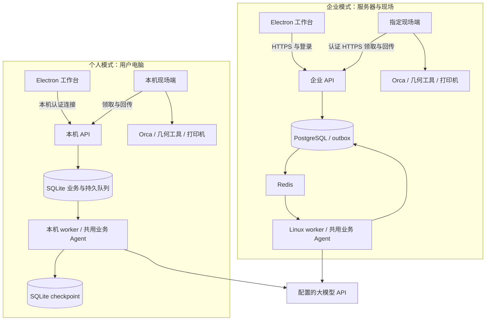

# 运行与部署

[English](../../en/architecture/runtime-and-deployment.md) | 简体中文

状态：目标运行设计。已实现开发宿主与个人 Fake 诊断，差距见[实现状态](../engineering/getting-started.md)。本文拥有双模式部署、后台生命周期、持久任务和现场协议；产品模式需求见[需求](../product/requirements.md)，代码位置见[仓库结构](repository.md)，角色定义见[Agent](agent-and-tools.md)。

## 部署模式与配置

同一款 Electron 软件提供两个入口：**个人使用**与**连接企业**。两种模式共用订单、模型、工艺、试打、生产、质量和 Agent 实现；企业增加组织协作、资源授权和集中运维。功能能否执行取决于模型能力、资料、设备、权限及人工确认，不能仅凭部署模式推断结果相同。

| 项目 | 个人本地模式 | 企业服务器模式 |
| --- | --- | --- |
| 开始使用 | 安装软件，填写 API 地址、API Key、模型名称并测试连接 | 填写企业服务器地址并登录，模型由管理员配置 |
| 业务控制端与 Agent | 本机独立后台 | 企业内网服务器或云服务器 |
| 业务持久化 | 工作区 SQLite，SQLAlchemy 与 Alembic 管理 | PostgreSQL，SQLAlchemy 与 Alembic 管理 |
| Agent checkpoint | 独立 SQLite checkpoint 存储 | PostgreSQL checkpoint 存储 |
| 后台执行 | 本地 SQLite 持久队列、单实例调度与有界执行进程 | Linux Celery / Redis、有执行租约的 worker |
| 文件与检索 | 本地受管理文件、SQLite 文本检索 | 服务端文件或 S3、PostgreSQL 文本检索 |
| Orca 与设备接入 | 安装包提供的本机现场端 | 登记在企业中的现场端，可部署在用户电脑或专用现场主机 |
| 身份 | 本机所有者、工作区授权、本地端点认证 | 企业 OIDC、成员身份、RBAC 与资源授权 |
| 运行依赖 | 安装包提供，用户无需安装开发工具或服务 | 管理员部署数据库、队列、身份与后台；桌面用户无需部署 |

个人版不要求 Autumn 云账号、企业服务器、Docker、Redis、PostgreSQL 或本地 GPU。使用远程模型 API 需要可达网络和有效额度；使用本机模型服务时，用户另行提供模型服务。模型服务的 API 兼容性通过工具调用、结构化输出及可选视觉能力检查，检测失败给出具体原因，不悄悄切换成模拟模式。

个人版的 API Key 只由本机模型适配器使用，通过系统凭据保护存储；配置界面只在输入提交期间短暂接收，保存后不回显或长期保留，模型消息、日志与协议回执不包含 Key。企业模型凭据保存在服务端。模型 API 地址不是企业服务器地址，两项配置在界面与数据模型中分别命名。

“数据保存在本机”不等于“推理不出本机”：远程模型只收到当前任务获准发送的内容与必要成果，不默认上传全部模型或整个文件目录。用户应能看到当前模型连接、任务资料范围和使用记录。

## 双模式进程关系

## 本地后台、持久任务与生命周期

个人安装包包含桌面、受管理 Python 运行环境、API、本地 worker、现场端、几何依赖及经过发布审查的固定 Orca 运行资源，附带获准样例和兼容工艺配置供首次体验。引擎来源、许可/源码提供义务、摘要与兼容配置是发布验收项。默认个人安装包必须满足离线安装运行依赖；大模型网络调用除外。复用已有引擎是可选高级配置；真实打印仍需用户连接设备、确认材料及准备条件。

`apps/worker` 的本地宿主入口由安装程序登记为当前用户的受管理后台，负责启动与监督 API、本地调度进程和现场端；它们与 Electron 窗口分别运行。后台异常由操作系统的受管理启动机制恢复，不能仅由窗口内存承担监管。启动使用工作区锁和实例标识，同一工作区已有后台时只连接。

本地 API 仅绑定 loopback，使用每安装/工作区的受保护凭据、调用方与来源校验；桌面与现场端获得不同权限。数据库、文件、queue、checkpoint 和动作日志存于用户数据目录，不写安装目录或源码仓库；不同工作区数据与凭据隔离。后台端口由受保护的发现记录提供，不能盲信同端口进程。

本地任务提交与业务记录同事务写入业务 SQLite 队列表；单调度器原子领取、登记租约和执行尝试，有限并发执行有界片段。SQLite 使用 WAL、短事务、忙等待上限、外键与显式唯一约束；不依赖 PostgreSQL 的行锁、RLS 或 `SKIP LOCKED`。checkpoint 独立存储，其提交不与业务事务假定原子：恢复通过业务幂等键、run 版本和动作记录核对。

等待人工输入、现场结果、网络或模型连接时，保存进度并释放执行槽位；恢复固定图版本。租约过期触发状态核查与可恢复片段重投，设备结果未知不能变成再次启动。企业 outbox/Celery 采用相同业务幂等与等待语义，一个工作区只启用一种调度后端。

关闭窗口或退出桌面只结束交互，后台与已执行设备作业继续。停止后台为独立操作：先停止领取、保存可恢复状态并说明在途动作；杀进程不等于停止打印。电脑关机或休眠期间软件不运行、不保证继续监控；重启/唤醒后先核对设备及动作结果。

## 工作区、断网与个人到企业迁移

首次选择个人模式时创建本地工作区与所有者身份，不要求部署 OIDC；所有者确认仍记录具体人、版本与证据。企业连接使用 OIDC 与企业资源策略。桌面每次请求固定工作区、端点与身份，事件和缓存按工作区隔离；切换界面不转移正在运行任务，不改变现场设备控制权。

个人模式没有企业服务器依赖，可离线查看、编辑、运行确定性工具；需要远程模型的步骤在断网时等待，恢复后按预算继续。已批准且条件有效的现场任务依本机策略执行。企业断网时显示缓存与草稿，禁止新的服务端审批、领取和启动；现场端只完成已接受且授权条件仍有效的任务并持久保存回执，重连核对。

个人与企业数据不自动同步、合并或后台上传。迁移通过显式导出/导入包，校验权限、hash、模型/工艺版本及引用；不复制个人模型 Key 或现场凭据。企业导入不沿用个人所有者的组织授权，历史批准作为历史证据保存，生产使用按企业策略重新确认。活跃任务和未核清设备动作不跨模式迁移。

设备写入归属在两个模式间互斥：现场端同时仅服务一个控制端/站点身份；切换需停止领取并核清在途动作、解除旧绑定，再由操作者登记，不能个人与企业同时自动启动同台打印机。

## 后台任务、恢复与重投

通过任务执行 Interface 装配两种后端，共用 run/事件/幂等/等待/取消语义；LangGraph 管片段内部状态，当前业务数据库持有业务事实。一个工作区只启用一种调度后端。

- **个人：** SQLite 业务事务同时写入任务与持久队列；单实例调度器原子领取、登记租约、有限并发执行有界片段，WAL 与短事务限制锁竞争。checkpoint 使用独立 SQLite 存储，不假定它与业务记录跨库原子提交；崩溃后通过幂等键与业务版本核对恢复，不采用 PostgreSQL 专用行锁语法。
- **企业：** Linux Celery + Redis 执行有界片段，PostgreSQL outbox 与执行租约保障可追查交接。下列派发细节适用于企业后端；幂等、等待和外部结果核查规则也适用于本地后端。相关支持与重投依据见 [Celery FAQ](https://docs.celeryq.dev/en/stable/faq.html)、[Redis broker](https://docs.celeryq.dev/en/stable/getting-started/backends-and-brokers/redis.html)。

1. 创建任务时同一事务写业务记录、初始事件和 outbox。
2. 派发器发送仅含业务 ID、版本和关联信息的 JSON 消息，不用 pickle，不传原始大文件。
3. Worker 条件获取对应 run 的有效执行租约，检查已完成结果和取消状态后执行。
4. 每个并发分支有独立 Session；连接在子进程初始化，事务不跨模型调用和外部等待长期持有。
5. 同步 Celery 入口优先使用同步图调用和独立会话；异步模型若必须接入，建立明确的循环/客户端生命周期，不跨线程或旧循环复用 AsyncSession。
6. 等待测量或审批时保存 checkpoint 并结束片段，收到新业务事件后再派发恢复；不让 worker 挂起数日。远程切片先提交唯一 SliceRun，等待现场端结果后以关联事件恢复，不占住 worker 轮询离线现场端。
7. checkpoint 的访问经租户/任务归属检查，同一 run 单写，恢复固定图版本；中断节点重入不绕过动作账本。
8. Outbox 重发、broker 重投及人工恢复复用业务幂等键，分别计数传输尝试与模型/工具重试。
9. 定期核对 queued/过期租约/已派发未领取的业务记录；Redis 消息丢失或 broker 恢复也可由业务记录重新派发。
10. 普通任务失败与外部动作结果未知分开；后者只触发结果查询或人工核查。

Redis 的持久化和可用性是运行配置，不能替代 PostgreSQL 记录。Redis 8+ 的许可有版本差异，镜像须固定并按其[官方许可](https://redis.io/legal/licenses/)核查；本设计不默认所有版本仍是 BSD。

Temporal 暂不采用。未来若引入耐久业务编排，应替换对应外层调度并重审 checkpoint 所有权，不叠加多套独立重试体系。

## Electron 桌面进程与本地集成

### 主进程、preload 和界面层

| 进程/层 | 持有的职责 | 对外只暴露的能力 |
| --- | --- | --- |
| Main | 窗口、系统文件选择、账号会话、受信任后台连接、升级和现场端生命周期状态 | 明确命令、查询与订阅，不提供通用文件/网络/Shell 代理 |
| Preload | contextBridge 类型化能力桥 | 业务名称、参数结构、返回值、订阅取消；不暴露整个 ipcRenderer |
| Renderer | React 页面、Three.js 视图、表单与展示 | 调用经过校验的业务能力；不使用 Node、设备凭据或任意本地路径 |
| Python Edge | Orca/几何子进程、设备 Adapter、本地动作记录 | 领取受授权任务并回传结果；不由聊天文本直接控制进程 |

窗口基线为 `nodeIntegration: false`、`contextIsolation: true`、`sandbox: true`。Main 校验 IPC 发送来源和参数；未知频道拒绝。外链经协议和域名规则验证后交系统浏览器；阻止任意窗口导航、弹窗和远程脚本进入特权界面。CSP 与受限 `app://` 协议处理分别验证，禁用路径穿越和无范围本地文件读取。[Electron 官方安全指南](https://www.electronjs.org/docs/latest/tutorial/security)

选文件时 Main 取得文件授权并建立导入引用，再上传/交受管理执行端读取。Renderer 中的模型名称、拖放项或模型回复不能直接变成任意磁盘路径。图片、模型和报告等导入内容按不可信数据处理，报告 HTML/Markdown 不执行任意脚本。

### 客户端与后端通信

主进程持有受限会话并接收后台 SSE，向 renderer 转发已授权、带序号的业务事件。Renderer 通过 `orders.create`、`tasks.subscribe`、`models.selectImport` 等小 Interface 工作；请求具有 ID、取消、超时、结构化错误与资源范围。

大模型、GLB、照片和 G-code 不经频繁 JSON IPC 复制；使用受鉴权资源引用、流式下载与受限临时文件。主进程或专用后台执行网络流与转换，避免阻塞窗口。订阅断开只结束观察，取消业务任务必须调用独立命令。

### 关闭窗口、退出与离线

- 关闭窗口和停止现场端是不同动作。生产设备由现场端管理；关界面不能自动取消打印或再次启动作业。
- 个人安装程序登记当前用户的独立后台宿主，监督本机 API、worker 与现场端；桌面启动时连接或请求启动后台，窗口退出后后台继续，操作系统负责异常重启。企业 API/worker 在服务器，现场端作为独立受管理进程/服务运行。各进程记录版本、路径、健康和退出原因。
- 同一现场设备只有一套获准执行实例。已有服务运行时，第二个客户端只能连接，不能再启动一个争夺设备的执行端。
- 网络断开显示离线与最后观测时间，已在设备上运行的作业按设备自身生命周期继续；恢复后先核查状态与回执。
- 个人不依赖企业服务器，断网时可使用本地数据和确定性工具，需要远程模型的步骤等待；有效本地批准仍按策略执行。企业断网仅允许缓存/草稿及现场端完成已接受且授权仍有效的任务，禁止新的服务端审批与领取。关机/休眠期间软件不运行，恢复先核对设备结果。
- 取消切片可以终止相应受控子进程；软件窗口退出不等于硬件级停止。

### 打包与更新

采用一条构建链：**electron-vite 构建 Main/Preload/Renderer，electron-builder 打包，electron-updater 管选定更新渠道**。Forge 是替代方案，本次不与之混用；其官方 Vite 插件仍标实验状态，需要单独承担兼容风险。[Forge Vite 插件文档](https://www.electronforge.io/config/plugins/vite)

首个交付目标为 Windows x64 安装包，随后验证用户实际需要的 ARM64/macOS/Linux。Python 运行、几何原生库和 Orca 是独立版本化依赖；不能认为 asar 自动打包并隔离了这些工具。Orca 安装、随包分发及组件许可在发布方案中明确核查。

个人安装包必须提供运行依赖与经审查的固定引擎资源，完成本地后台登记、数据初始化、版本迁移和健康检查；用户只需在界面选择个人模式并配置模型 API，不需安装开发工具或企业服务。API 仅绑定 loopback 且验证本机身份，不能因为本地连接就免鉴权。模型 Key 由本机模型 Adapter 使用系统凭据保护，不进入 renderer；企业 Key 仅在服务器。个人与企业构建分别裁剪依赖。

桌面更新需验证来源、签名、摘要、协议兼容和可恢复安装；不会自动替换正在使用的引擎或在设备动作中途停止现场端。客户端、后端、Edge 与工具记录兼容范围，更新不受支持时进入只读/等待处理并给出原因。开发版、正式版、预发布渠道分开；本轮未创建证书或发布更新。

## 现场执行端与设备动作协议

企业现场端通过出站 HTTPS 注册/认证、领取任务、心跳与回传，不直接连接中心数据库，不暴露打印机公网入口。个人现场端通过受认证 loopback 使用相同版本化命令/回执协议，以本地所有者授权替代企业站点登记。现场端同时只绑定一个控制端，个人/企业切换需核清在途动作再重新登记，禁止双控制端自动开打。

每条命令包含 schema 版本、tenant/site、任务/动作 ID、目标设备、文件 hash、配置/批准版本、允许动作、有效期与领取标识。现场端重新验证作用域、输入完整性与过期状态，不能只相信前端已检查。

| 动作状态 | 含义与下一步 |
| --- | --- |
| proposed | Agent/用户提出，尚未获得执行授权 |
| awaiting_approval | 等待明确对象与版本的批准 |
| ready | 批准和前置条件满足，仍需执行前复查 |
| dispatching | 已持久记录意图并准备交给指定现场端 |
| accepted | 现场端已持久接收，尚不等于设备已开始 |
| confirmed | 能关联到设备实际结果或明确回执 |
| unknown | 可能已经生效但证据不足，只允许核查或人工处理 |
| rejected / cancelled | 未执行或已确认取消的相应动作；保留发生范围 |

上传、排队、启动、暂停、继续和取消是不同 Action。作业启动确认不等于作业完成；暂停请求成功也不等于机床级安全状态。

### 单写者与重放规则

1. 每台设备的 Autumn 写动作串行化；中心租约与现场进程锁共同约束领用。
2. SQLite 动作日志在网络请求前持久记录 action_id、文件 hash、状态与本地已知结果，重要落盘策略需要故障注入验证。
3. 重复命令命中已知结果就返回记录；未知状态先查本地日志和设备任务/文件/历史，不能关联时转人工。
4. 中心租约过期不自动授权第二现场端再次启动打印；失联切换先核查旧执行者与物理设备。
5. 重新核对设备空闲、观测新鲜度、喷嘴、实际材料、清床与批准条件后才启动。
6. 原生面板或其他软件仍可能控制设备。检测到外部占用、文件或状态不符时停止自动推进，不能宣称全场景“恰好一次”。
7. 若通过 SimplyPrint/Printago 调度该设备，则选其为排队与启动拥有者，Autumn 不同时运行另一套自动开打队列。

先实现 Fake，并通过重复、超时、断网、外部占用测试，再接一台获准测试设备。Klipper 设备优先评估 Moonraker；已有 OctoPrint 就先用其实际接口；其他品牌逐一增加能力记录。

## 部署、版本与恢复

开发环境按固定 Monorepo 布局构建。个人配置原生启动本机 API、持久队列 worker、SQLite 和现场端；企业集成配置使用 Docker Compose 提供 API、Linux worker、PostgreSQL、Redis 与身份提供方。Compose 是企业/开发部署工具，不是个人用户的使用前提。现场 Windows 仍运行原生工具。

企业部署可把控制端放在内网服务器/云端，现场端通过出站连接接入；Electron 选择经管理员确认的服务端地址。正式环境启用 TLS、身份、凭据轮换、数据备份和最小资源权限。

个人数据在用户数据目录，与安装目录隔离；企业数据在企业存储。桌面工作区固定端点、身份与缓存，切换不迁移任务，也不自动上传个人资料。个人转企业采用显式导出/导入、hash/版本/权限核对及企业重新确认，排除模型 Key、设备凭据与活跃任务。SQLite 备份采用一致性快照，不能运行中只复制主数据库而遗漏 WAL；文件、业务库和 checkpoint 通过清单与恢复核对保持关联。

版本记录覆盖客户端、后端 Interface、edge 协议、图/角色、模型、配置、引擎、解析器与原生工具。客户端/现场端先协商能力，更新不兼容时阻止写动作。数据库迁移、备份、文件与 checkpoint 保留策略必须配套演练，不假定降级二进制即可回滚数据。

首期本地 ArtifactStore 需备份文件及对应元数据；迁移 S3 验证对象长度、hash 和版本关系。恢复后先核对设备实际状态，再继续派发；备份中的旧动作不能被当成全新的启动授权。

## 实施前待定的运行细节

Windows 个人后台的具体登记机制、首次凭据创建/交接和升级卸载顺序尚需实现验证；不得把「受管理后台」视作已经完成。开发初始化通过 Fake 工具验证协议与生命周期，真实安装包另按[验证计划](../engineering/validation.md)验收。
